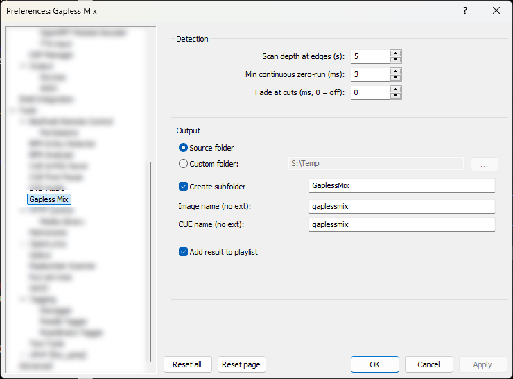

# Gapless Mix for foobar2000

[🇬🇧 English](#english) | [🇷🇺 Русский](#русский)

---

---

## English

**Gapless Mix** is a foobar2000 component that joins selected tracks into a continuous gapless mix. The plugin scans the specified regions at the edges of the tracks being joined, finds and removes digital silence (holes), and seamlessly joins the audio. Perfect for live albums, non-stop mixes, and bootlegs with artificial pauses between tracks.

### Features
- Finds and removes **absolute zero** (digital silence) holes at track boundaries.
- Applies a short **fade at cuts** (optional) to avoid clicks when joining audio.
- Merges adjacent and overlapping detected holes to avoid double cuts.
- **Image + CUE** mode: produces a single WAV file and a CUE sheet with correct track boundaries.
- **Tracks** mode: produces individual WAV files, preserving original filenames.
- Preserves the **original audio format** (bit depth, sample rate, float/int, channel layout) — no resampling, no dithering.
- Copies tags and album art (front, back, disc, icon, artist) to the output.
- Strips ReplayGain data from the output.
- Integrates into **Utilities → Make Gapless** context menu.
- Settings page in **Preferences → Tools → Gapless Mix** with dark mode support.
- Settings are automatically saved between foobar2000 restarts.

### Usage
1. Select two or more consecutive tracks in a foobar2000 playlist.
2. Right-click → **Utilities** → **Make Gapless** → choose either:
   - **Image + CUE** — single WAV + CUE sheet.
   - **Tracks** — individual WAV files.
3. Wait for the process to finish. The result is saved to the source folder (or a custom folder, if specified) and optionally added to the active playlist.

### Settings
| Option | Description | Default |
|--------|-------------|---------|
| **Scan depth at edges (s)** | How many seconds at the start and end of each track are scanned for holes. | `5` |
| **Min continuous zero-run (ms)** | Minimum length of a continuous zero sequence to be considered a hole. Shorter gaps are ignored. | `5` |
| **Fade at cuts (ms, 0 = off)** | Length of fade-in/fade-out applied at cut points (only when a hole is removed and signal levels differ). | `0` |
| **Save to source folder** | Save output to the source folder of the first track. | On |
| **Custom output directory** | Save output to a specified folder. | (empty) |
| **Create subfolder** | Create a subfolder for the output inside the chosen directory. | On |
| **Subfolder name** | Name of the subfolder. | `GaplessMix` |
| **Image file name (no ext)** | Name of the output WAV in Image+CUE mode. | `gaplessmix` |
| **CUE file name (no ext)** | Name of the output CUE in Image+CUE mode. | `gaplessmix` |
| **Add result to playlist** | Add output files to the active playlist after processing. | On |

### Supported formats
- **Lossless only** (FLAC, WAV, ALAC, WavPack, AIFF, Monkey's Audio, etc.). Lossy formats (MP3, AAC, OGG, Opus) are rejected — they cannot contain true digital silence in the way this plugin relies on.
- All selected tracks must have the **same sample rate, channel count, bit depth, and sample type** (float/int). Otherwise the plugin will refuse to process.

### Building
- Visual Studio 2022 (v143) or later.
- foobar2000 SDK (latest).
- Place the `foo_makegapless` folder alongside the SDK (`foobar2000/SDK/`, `foobar2000/helpers/`, `pfc/`, `libPPUI/`, `WTL/`).
- In **Additional Include Directories** (for all configurations), add the project root (`..`), the foobar2000 SDK folder (`..\foobar2000`), and the WTL include path (`..\WTL\Include`).
- Link against the SDK project dependencies (`pfc`, `foobar2000_SDK`, `foobar2000_sdk_helpers`, `foobar2000_component_client`, `shared`).

---

## Русский

**Gapless Mix** — компонент для foobar2000, который сводит выбранные треки в непрерывный gapless-микс. Плагин сканирует заданные промежутки по краям сводимых трека, находит и удаляет цифровую тишину (дыры) и бесшовно соединяет аудио. Идеально подходит для концертных альбомов, нон-стоп миксов и бутлегов с искусственными паузами между треками.

### Возможности
- Находит и удаляет **абсолютные нули** (цифровую тишину) на стыках треков.
- Применяет короткий **фейд на месте выреза** (опционально) для избежания щелчков при склейке.
- Объединяет соседние и пересекающиеся найденные дыры, чтобы не резать дважды.
- Режим **Image + CUE**: создаёт единый WAV-файл и CUE-лист с корректными границами треков.
- Режим **Tracks**: создаёт отдельные WAV-файлы с сохранением оригинальных имён.
- Сохраняет **исходный формат аудио** (разрядность, частоту дискретизации, float/int, расположение каналов) — без ресемплинга и dither.
- Копирует теги и обложки (front, back, disc, icon, artist) в выходные файлы.
- Удаляет данные ReplayGain из выходных файлов.
- Встраивается в контекстное меню **Utilities → Make Gapless**.
- Страница настроек в **Preferences → Tools → Gapless Mix** с поддержкой тёмной темы.
- Настройки автоматически сохраняются между перезапусками foobar2000.

### Использование
1. Выделите два или более последовательных трека в плейлисте foobar2000.
2. Кликните правой кнопкой → **Utilities** → **Make Gapless** → выберите:
   - **Image + CUE** — единый WAV + CUE-лист.
   - **Tracks** — отдельные WAV-файлы.
3. Дождитесь завершения процесса. Результат сохраняется в папку исходников (или в кастомную папку, если указана) и опционально добавляется в активный плейлист.

### Настройки
| Параметр | Описание | По умолчанию |
|----------|----------|--------------|
| **Scan depth at edges (s)** | Сколько секунд в начале и конце каждого трека сканируется на наличие дыр. | `5` |
| **Min continuous zero-run (ms)** | Минимальная длина непрерывной последовательности нулей, чтобы считать её дырой. Более короткие пропуски игнорируются. | `5` |
| **Fade at cuts (ms, 0 = off)** | Длина fade-in/fade-out, применяемого в точках выреза (только если дыра удалена и уровни сигнала различаются). | `0` |
| **Save to source folder** | Сохранять результат в папку исходников первого трека. | Вкл. |
| **Custom output directory** | Сохранять результат в указанную папку. | (пусто) |
| **Create subfolder** | Создавать подпапку для результата внутри выбранной папки. | Вкл. |
| **Subfolder name** | Имя подпапки. | `GaplessMix` |
| **Image file name (no ext)** | Имя выходного WAV в режиме Image+CUE. | `gaplessmix` |
| **CUE file name (no ext)** | Имя выходного CUE в режиме Image+CUE. | `gaplessmix` |
| **Add result to playlist** | Добавлять выходные файлы в активный плейлист после обработки. | Вкл. |

### Поддерживаемые форматы
- **Только lossless** (FLAC, WAV, ALAC, WavPack, AIFF, Monkey's Audio и т.д.). Lossy-форматы (MP3, AAC, OGG, Opus) отклоняются — они не содержат истинной цифровой тишины, на которую опирается плагин.
- Все выбранные треки должны иметь **одинаковую частоту дискретизации, число каналов, разрядность и тип сэмплов** (float/int). Иначе плагин откажется обрабатывать.

### Сборка
- Visual Studio 2022 (v143) или новее.
- foobar2000 SDK (последний).
- Папку `foo_makegapless` разместить рядом с SDK (`foobar2000/SDK/`, `foobar2000/helpers/`, `pfc/`, `libPPUI/`, `WTL/`).
- В **Additional Include Directories** (для всех конфигураций) добавить корень проекта (`..`), папку SDK foobar2000 (`..\foobar2000`) и путь к WTL (`..\WTL\Include`).
- Подключить зависимости проектов SDK (`pfc`, `foobar2000_SDK`, `foobar2000_sdk_helpers`, `foobar2000_component_client`, `shared`).